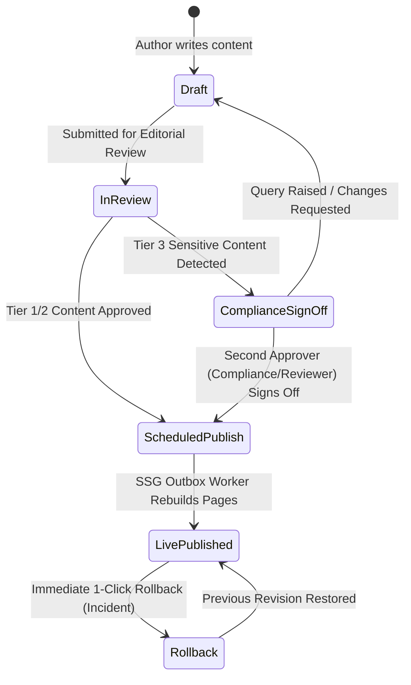

# Simal Corporate Platform: Content Governance & Publishing Policy

**Document Reference:** GOV-POL-CMS-2026 (v3.0 Ratified)  
**Status:** RATIFIED & ENFORCED  
**Effective Date:** 2026-10-14  
**Authority:** Corporate Governance Committee & Lead Compliance Officer  
**Remediation Plan Traceability:** Phase 9 (P9-4, SEC-11, FRS-RC-11/F4)  
**Enforcement Engine:** `apps/portal/src/services/cms.service.js`, `apps/portal/src/services/routes.js`  
**Cross-References:** [`docs/GOVERNANCE_REQUIREMENTS_BASELINE.md`](file:///F:/software_project/Sofoware_project_04/Simal_Corporate_website/Codebase/docs/GOVERNANCE_REQUIREMENTS_BASELINE.md), [`Project_doc/06_Operations/Content_Governance_and_CMS_Guide.md`](file:///F:/software_project/Sofoware_project_04/Simal_Corporate_website/Project_doc/06_Operations/Content_Governance_and_CMS_Guide.md)

---

> [!IMPORTANT]
> **GOVERNANCE MANDATE: DUAL-APPROVAL CONTENT WORKFLOW**
> All modifications to digital content published across the Simal Corporate digital platform must comply with the multi-tier review and approval lifecycle codified in this policy. In particular, **no change to pricing claims, Peppol/statutory compliance dates, or brand-authorization wording may be published without an explicit, recorded second approval from an independent authorized reviewer (`approved_by != author_id`)**.

---

## 1. Purpose & Scope

The Simal Corporate Web & Portal Ecosystem is an authoritative B2B digital channel representing commercial distribution rights for 22 global hardware brands, enterprise software solutions, and UAE Federal Tax Authority (FTA) regulatory compliance interfaces.

Uncontrolled or unilateral modifications to public claims introduce severe commercial, legal, and regulatory liability. This policy establishes the formal information governance architecture, segregation of duties, multi-stage approval lifecycles, and rollback protocols governing all content assets.

This policy applies to:
- Simal Corporate Public Static Site (`apps/site`, 240+ pages in English and Arabic).
- Simal Content Studio (`apps/portal/public/cms.html`).
- All REST API administrative endpoints (`/api/cms/*`).

---

## 2. Content Classification Tiers

All content entities in PostgreSQL are categorized into three governance tiers:

```
┌────────────────────────────────────────────────────────────────────────┐
│                      CONTENT CLASSIFICATION TIERS                      │
├────────────────────────────────────────────────────────────────────────┤
│ TIER 1: Standard Marketing Copy                                        │
│ • Blog articles, newsroom releases, careers copy, layout banners       │
│ • Single Editor approval sufficient for standard scheduled publish     │
├────────────────────────────────────────────────────────────────────────┤
│ TIER 2: Commercial Product & Technical Catalog                         │
│ • Hardware SKUs, technical spec matrices, category guides              │
│ • Catalog Specialist authoring + Reviewer verification                 │
├────────────────────────────────────────────────────────────────────────┤
│ TIER 3: Compliance-Sensitive Content [SEC-11 DUAL-APPROVAL MANDATORY]  │
│ • Pricing claims & commercial discount packages                        │
│ • Peppol statutory compliance dates & regulatory FTA disclosures       │
│ • Authorized distributor badges & vendor legal authorization wording   │
│ • Mandatory two-person rule: Author + Independent Compliance Reviewer  │
└────────────────────────────────────────────────────────────────────────┘
```

### Detailed Tier Definitions

1. **Tier 1 — General Marketing & Editorial:**
   - Entities: `insight` (articles), `careers-roles`, `testimonials`, `hero_slides` (general marketing slides).
   - Sensitivity: Low to medium.
   - Requirement: Authoring by Content Contributor/Editor; standard peer review before push.

2. **Tier 2 — Hardware Catalog & Technical Specifications:**
   - Entities: `products` (78 SKUs), `product_deep` (technical specs), `brands` (descriptions, logos).
   - Sensitivity: Medium.
   - Requirement: Authoring by Product Catalog Specialist; technical verification by Reviewer.

3. **Tier 3 — Compliance-Sensitive Content (Mandatory Dual-Approval):**
   - **Pricing Claims:** Any reference to pricing models, ERP implementation packages (`erp/pricing`), payment terms, or credit limits.
   - **Brand Authorization Claims:** Any text or badge claiming "Authorized Distributor", "Official Partner", or exclusive distributorship rights (`claims-register`, `brand-auth`, `authorization`).
   - **Peppol & Statutory Compliance Dates:** Any published date regarding statutory FTA e-invoicing milestones, ASP appointment deadlines, or tax mandates (`compliance-dates`, `peppol-dates`, `legal_policies`).
   - **Enforcement Rule:** **A Tier 3 change CANNOT transition to live status without recorded sign-off from a second active staff member who is distinct from the author (`secondApproverEmail != authorEmail`).**

---

## 3. Four-Stage Publication Lifecycle

All content transitions through four formal lifecycle states:



### State Definitions
1. **Draft (`draft`):** Content is saved in PostgreSQL with author attribution. Changes are visible only in the internal Content Studio preview.
2. **In Review (`review`):** Content is frozen for editorial and technical validation.
3. **Compliance Sign-Off (`compliance_review`):** Mandatory for Tier 3 content. A distinct staff member with role `compliance_officer`, `reviewer`, or `super_admin` inspects legal claims and approves.
4. **Scheduled / Published (`published`):** Change is committed to live data tables, snapshotted into `cms_revisions`, enqueued in PostgreSQL `outbox`, and triggers automated Astro SSG static regeneration.

---

## 4. Technical Dual-Approval Enforcement (SEC-11)

Technical enforcement is hard-coded within the core API gateway:

### API Gateway Enforcement (`cms.service.js`)
When `/api/cms/publish` or `/api/cms/emergency-publish` is invoked:
1. The gateway inspects the target entities against `isSensitiveEntity()`:
   - Entity or key matching `pricing`, `erp/pricing`, `brand-auth`, `authorization`, `claims-register`, `compliance-dates`, `peppol-dates`.
2. If sensitive content is detected:
   - The gateway validates `secondApproverEmail`.
   - The gateway enforces `secondApproverEmail.toLowerCase() !== session.user.email.toLowerCase()`.
   - The gateway queries the PostgreSQL `users` table to ensure the second approver is an active staff account with role `reviewer`, `compliance_officer`, or `super_admin`.
   - If invalid or missing, the gateway rejects the request with **HTTP 403 Forbidden**:
     ```json
     {
       "error": {
         "code": 403,
         "message": "Dual approval required: publishing sensitive content requires a distinct active second approver sign-off (secondApproverEmail) per SEC-11 Content Governance Policy"
       }
     }
     ```
3. Upon valid dual-approval, the action is written to the immutable audit log:
   `repos.audit(actor, 'cms_published', entityReference, 'dual-approved by ' + secondApproverEmail)`

### Emergency Fast-Lane Protocol
For critical production corrections (e.g., rectifying a legal typo or outdated regulatory date):
- Endpoint: `POST /api/cms/emergency-publish`.
- Allowed Roles: `reviewer`, `compliance_officer`, `super_admin`.
- Rule: Reviewers must provide a valid distinct second approver. Only `super_admin` may execute an emergency override, and all overrides are permanently tagged with `(super_admin override)` in the security audit trail.

---

## 5. Versioning & Instant Rollback Protocol

To guarantee continuous availability and rapid incident recovery:
1. **Immutable Snapshotting:** Every write operation (`INSERT`, `UPDATE`, `DELETE`) across `content_blocks`, `hero_slides`, `announcements`, `testimonials`, `products`, and `legal_policies` creates an immutable JSON snapshot in PostgreSQL `cms_revisions`.
2. **Rolling History:** A rolling history of the last 10 revisions is retained per entity.
3. **1-Click Rollback:**
   - Any prior revision can be restored with a single command or button click (`POST /api/cms/rollback`).
   - The rollback operation itself snapshots the pre-rollback state, ensuring rollbacks are fully reversible and non-destructive.
   - Restoring a revision automatically enqueues a `cms_publish` outbox event, triggering instant Astro SSG regeneration.

---

## 6. Audit Trail & Regulatory Compliance

In conformance with UAE Federal Decree-Law No. 45 of 2021 (PDPL) and ISO 27001 Annex A.12:
- Every content authoring, review, publication, and rollback event is recorded in PostgreSQL `audit_log`.
- Log entries capture:
  - Exact UTC timestamp (`ts`).
  - Actor email address (`actor`).
  - Action name (e.g., `cms_block_upserted`, `cms_published`, `cms_rollback`, `cms_emergency_publish`).
  - Target entity reference (e.g., `erp/pricing`, `brands/hp`).
  - Dual approval metadata (`dual-approved by officer@simalme.com`).
- Audit logs are append-only and retained for **≥ 5 years**.

---

## 7. Policy Governance & Sanctions

Any attempt to bypass the dual-approval mechanism, forge approver identities, or deploy unverified commercial or compliance claims constitutes a direct violation of corporate information security controls, triggering immediate revocation of CMS administrative privileges and disciplinary escalation.

**Approved and Ratified:**
- **Corporate Governance Committee** · 2026-10-14
- **Lead Compliance Officer** · 2026-10-14
- **Lead Systems Architect** · 2026-10-14
